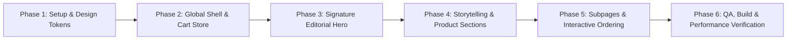

# Comprehensive Implementation Plan: Fryzo Premium Editorial Website

**Project:** FRYZO Premium Digital Experience  
**Creative Direction:** ONDERA-inspired Editorial Luxury meets Fast-Food Modernism  
**Palette:** Warm Cream (`#F7F3E9`), Deep Charcoal (`#111311`), Cyan-Green (`#00D6B2`), Turquoise (`#35E0CF`), Soft Mint (`#B8F3E7`), Pure White (`#FFFFFF`)  
**Status:** Architecture & Implementation Plan (Awaiting User Command to Execute)

---

## 1. Synthesis of Creative Direction & Technical Requirements

The goal is to elevate Fryzo from a generic WordPress food template into an **Awwwards-caliber, editorial-style brand experience** while strictly honoring the real brand assets, genuine product catalog, and company facts discovered during the initial audit.

### 1.1 Aesthetic & Compositional Principles (ONDERA Inspiration)
- **Dominant Cream Canvas (`#F7F3E9`):** 60–70% surface area providing warm luxury and editorial breathing room.
- **High-Contrast Deep Black/Charcoal (`#111311`):** 15–20% oversized typography, architectural line dividers, and high-impact contrasting focal sections.
- **Electric Cyan-Green (`#00D6B2`) & Turquoise (`#35E0CF`):** 10–15% high-energy accents on key words, pill borders, interactive hover states, and geometric frames.
- **Soft Mint (`#B8F3E7`) & White (`#FFFFFF`):** Reserved for subtle layer separation and floating card surfaces.
- **Oversized Swiss/Editorial Typography:** Tight letter-spacing, dramatic contrast between display serif/grotesk headlines and minimalist monospaced/uppercase editorial tags.
- **Asymmetrical Image Architecture:** Rounded picture windows (`rounded-2xl` / `rounded-3xl`), overlapping photo frames, angled badges, and magazine-style layout balance.

---

## 2. Technical Stack & Architectural Decisions

| Layer | Selection | Justification |
| :--- | :--- | :--- |
| **Framework** | **Next.js 15 (App Router, React 19)** | Server Components by default, instant page transitions, native SEO metadata generation, zero runtime overhead. |
| **Language** | **TypeScript (Strict Mode)** | Strict typing across product models, cart state, form validation, and layout components. |
| **Styling** | **Tailwind CSS v4 + PostCSS** | Custom token configuration for the approved cream/charcoal/cyan/turquoise palette; zero bloat. |
| **Motion** | **Framer Motion + CSS Transforms** | Subtle parallax, smooth reveal transitions, reduced-motion compliance without heavy JS lockup. |
| **Icons** | **Lucide React** | Clean, minimalist, geometric strokes that fit the editorial typography. |
| **State / Commerce** | **Zustand (Persistent Cart Store)** | Instant drawer cart with local storage persistence, quantity controls, and direct WhatsApp checkout string generator. |
| **Image Pipeline** | **Next.js Image (`next/image`)** | High-performance WebP/AVIF generation, preventing layout shifts with explicit aspect ratios. |

---

## 3. Page Structure & Editorial Storytelling Architecture

### 3.1 Global Navigation & Header
- Slim, elegant floating navigation on cream canvas.
- Distinctive FRYZO bold wordmark with mint/cyan accent dot.
- Minimal navigation items: `Our Craft`, `The Process`, `Products`, `Story`, `Contact`.
- Action CTA: Interactive **Cart Pill** with item count badge and **"Order Online"** button (`bg-brand-black text-brand-cream hover:bg-brand-cyan hover:text-brand-black transition-all`).
- Slide-over mobile editorial menu with responsive touch targets.

### 3.2 Homepage (`/`) — Section-by-Section Design
1. **Signature Editorial Hero (The Anchor Experience):**
   - **Oversized Headline:** Magazine-scale typography (e.g., *"GOLDEN CRISP.* *PERFECTED BY NATURE,* *ELEVATED BY CRAFT."*).
   - **Asymmetrical Hero Composition:** Central cinematic product cutout of Fryzo's signature golden straight-cut fries in an organic rounded frame, juxtaposed with an offset dark charcoal badge, editorial metadata tags (`EST. LAHORE, PK • 100% FARM POTATOES`), and an understated vertical scroll invitation.
   - **Motion:** Gentle typography fade-in, smooth floating card reveal, and subtle cursor/scroll parallax.
2. **Section A — Brand Introduction (Asymmetric 2-Column):**
   - Left: Large editorial statement on potato sourcing and culinary precision.
   - Right: Rounded frame showcasing raw potato washing and inspection.
   - Small monospaced CTA: `[ 01 / PHILOSOPHY ] → Explore Our Standard`.
3. **Section B — "From Farm To Fryer" (Industrial Craftsmanship Pipeline):**
   - 6 sequential milestones presented as an editorial timeline:
     `01. Procurement` → `02. Cleaning & Peeling` → `03. Precision Cutting` → `04. Blanching` → `05. Half-Frying` → `06. Flash-Freezing (-18°C)`.
   - Dark charcoal contrasting cards with cyan-green progress indicators and high-definition process graphics.
4. **Section C — The Product Gallery (Verified WooCommerce SKUs):**
   - Real products with editorial treatment, custom tags, pricing in PKR (`Rs`), and one-click quick add:
     - *Fryzo Straight Cut Fries 1.0 kg* (Daily Classic)
     - *Fryzo Straight Cut Fries 2.0 kg* (Family Pack)
     - *Fryzo Crinkle Cut Fries 2.0 kg* (Extra Crisp Surface)
     - *Fryzo Curly Fries 2.0 kg* (Seasoned Spiral Cut)
   - Interactive modal / side-drawer with nutritional specs and air-fryer/deep-fryer preparation guidelines.
5. **Section D — Cinematic Signature Feature:**
   - Full-bleed charcoal & cyan-green immersive banner: *"A Cold-Chain Distribution Network Delivering Farm Freshness Across Pakistan."*
   - Featuring the refrigerated delivery fleet visual and temperature-controlled standards.
6. **Section E — Executive Statement & Leadership:**
   - Editorial portrait frame of CEO **Mian Nauman Kabir**.
   - Clean typographic quote and signature layout.
7. **Section F — Interactive FAQ Accordion:**
   - Replaces template Latin text with verified culinary & storage FAQs (Storage conditions, shelf life, optimal frying temperatures).
8. **Section G — High-Impact Conversion CTA & Footer:**
   - Bold contrasting final call to action: *"Ready For The Ultimate Crunch?"*
   - Footer with verified contact channels (`info@fryzo.com.pk`), branch hours, social handles, and copyright notice.

### 3.3 Supporting Routes & Modals
- **`/about-us` (The Fryzo Story):** Deep dive into the company history, vision, agricultural partnerships, and manufacturing leadership.
- **`/shop` (Catalog & Ordering):** Filterable catalog by cut type and weight, live cart management, and Cash-on-Delivery (COD) / WhatsApp instant order dispatcher.
- **`/contact-us` (Inquiries & Outlets):** Direct inquiry form with client-side validation, store location hours, and direct customer care lines.

---

## 4. Phase-by-Phase Execution Plan

### Phase 1: Project Initialization & Design Tokens Setup
- Scaffold a clean Next.js 15 (App Router, TypeScript) application in the workspace.
- Configure Tailwind CSS with the approved palette:
  - `cream: '#F7F3E9'`
  - `black: '#111311'`
  - `cyan: '#00D6B2'`
  - `turquoise: '#35E0CF'`
  - `mint: '#B8F3E7'`
- Set up typography pairings (Plus Jakarta Sans / Syne for editorial display headlines + Inter for crisp body copy).
- Download and organize all high-resolution Fryzo product assets into `/public/images/`.

### Phase 2: Global Shell, Navigation & Persistent Cart
- Implement the sticky minimal header with brand wordmark and responsive mobile drawer.
- Implement the Zustand cart store with persistent state, drawer slide-over, quantity selectors, and direct WhatsApp checkout string generator.
- Implement the editorial footer and floating WhatsApp widget.

### Phase 3: Signature Hero Section (The Core Deliverable)
- Build the ONDERA-inspired asymmetrical hero layout:
  - Oversized headline with cyan-green text highlights.
  - Multi-layered product showcase in custom rounded frames (`rounded-3xl`).
  - Editorial metadata badges and subtle scroll invite.
  - Smooth entrance animations and Framer Motion micro-interactions.
  - Full mobile recomposition for 360px–768px screens.

### Phase 4: Homepage Editorial Sections
- Implement Section A: Brand Introduction with asymmetrical 2-column layout.
- Implement Section B: "From Farm To Fryer" 6-step industrial timeline.
- Implement Section C: Product Catalog grid with active cart triggers and price formatting.
- Implement Section D: Cinematic Cold-Chain Delivery section (contrasting black surface with cyan highlights).
- Implement Section E: CEO leadership quote and verified FAQ accordion.

### Phase 5: Supporting Pages (`/about-us`, `/shop`, `/contact-us`)
- Implement the dedicated `/about-us` route with mission/vision cards and partner strip.
- Implement `/shop` with category filters (Straight Cut, Crinkle, Curly).
- Implement `/contact-us` with responsive inquiry form and store details.

### Phase 6: Testing, Optimization & Final Verification
- Run `tsc --noEmit` for zero-error TypeScript validation.
- Run `next build` to verify production compilation and static generation.
- Audit responsive layouts across 360px, 390px, 768px, 1024px, and 1440px.
- Verify SEO metadata, OpenGraph tags, semantic landmarks, and accessibility contrast.
- Generate final delivery report.
