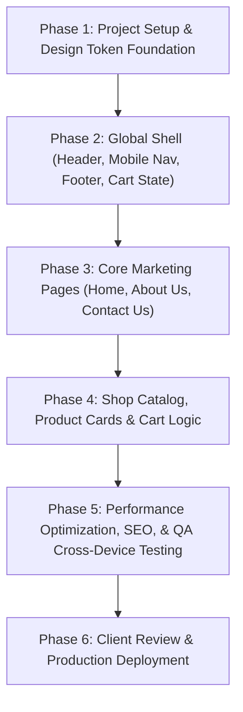

# Implementation Plan & Architecture Recommendation — Fryzo

This document outlines the architectural strategy, stack recommendation, trade-off analysis, and a structured phase-by-phase implementation plan for rebuilding the Fryzo website.

---

## 1. Architecture Evaluation & Recommendations

### Option A: Modern Headless React / Next.js 15 (App Router) + Tailwind CSS *(Recommended)*
- **Why this fits Fryzo:**
  - Fast page loads (<0.8s LCP), zero Elementor runtime bloat.
  - Native image optimization via `next/image` (WebP/AVIF automated resizing).
  - Built-in API routes for contact form submission, WhatsApp click-to-chat tracking, and checkout cart management.
  - SEO excellence with server components and automated OpenGraph / metadata.
- **Trade-offs:** Requires standard Node.js hosting (Vercel, Railway, VPS, or Docker container).

### Option B: Astro 5.0 + Tailwind CSS (Content-Focused Static + Island Architecture)
- **Why this fits:** 
  - Produces pure zero-JS static HTML for marketing pages.
  - Interactive islands only where needed (Cart, FAQ Accordions, Mobile Nav).
  - Can be hosted for free or near-zero cost on Cloudflare Pages, Netlify, or Apache/Nginx.
- **Trade-offs:** If a dynamic customer portal or complex real-time cart state is required later, full-stack Next.js is more flexible.

### Option C: Rebuilding on Fresh Headless WordPress / WooCommerce
- **Why this fits:** Keeps existing WordPress admin if client demands wp-admin dashboard.
- **Trade-offs:** Retains PHP maintenance, database security patches, and server overhead.

> **Recommendation:** **Option A (Next.js 15 + React 19 + Tailwind CSS + TypeScript + Lucide Icons)**. It provides the highest visual fidelity, superior mobile experience, instant navigation, and seamless e-commerce cart capability.

---

## 2. Page-by-Page Implementation Checklist

### Global Shell & Layout
- [ ] Responsive navigation bar with desktop links and animated mobile drawer.
- [ ] Top utility bar / announcement header (e.g. Nationwide Delivery, Discount alerts).
- [ ] Global Footer with newsletter subscription, store locations, social links, and legal notice.
- [ ] Floating WhatsApp quick-action button with prefilled order prompt.
- [ ] Cart drawer / slide-over state with persistent local storage.

### Page 1: Homepage (`/`)
- [ ] **Hero Section:** High-performance responsive hero banner replacing Slider Revolution with lightweight CSS/Framer-Motion animation.
- [ ] **Brand Highlights:** Quick stats/cards (Hygienic, Farm Fresh, 100% Quality).
- [ ] **From Farm To Fryer:** Interactive 6-step timeline with custom icons and micro-interactions.
- [ ] **Product Spotlight / Combo Grid:** Clean interactive package cards with quantity picker and "Add to Cart" trigger.
- [ ] **Logistics & Delivery Banner:** Showcase cold-chain distribution network.
- [ ] **FAQ Accordion:** Accessible keyboard-friendly accordion (`aria-expanded`) with real Fryzo product & storage information.
- [ ] **Store Locator & Hours:** Structured tabular layout for Somerville, Holmdel, and Westwood branches (or local Pakistani branches as confirmed by client).

### Page 2: About Us (`/about-us`)
- [ ] **Brand Story Hero:** Visual layout with brand badges.
- [ ] **Mission & Vision:** Side-by-side card grid with high-contrast typography.
- [ ] **Team Grid:** Modern avatar cards with role labels and social links.
- [ ] **Partner Logo Strip:** Infinite marquee or accessible grid for brand supporters.
- [ ] **Leadership Statement:** CEO quote card with photo (`Mian Nauman Kabir`).

### Page 3: Contact Us (`/contact-us`)
- [ ] **Contact Channels:** Store locations, customer care phone, email (`info@fryzo.com.pk`).
- [ ] **Interactive Contact Form:** Inputs for Name, Phone, Email, Subject, and Message with client-side validation.
- [ ] **Interactive Map / Location Embed:** Responsive Google Maps or OpenStreetMap embed.
- [ ] **FAQ Quick Links:** Direct link to common questions.

### Page 4: Shop Catalog (`/shop`) & Cart Flow
- [ ] **Product Grid:** Responsive grid (1 col mobile, 2 col tablet, 4 col desktop) showing all 4 SKUs.
- [ ] **Product Filter / Sort:** Filter by Cut type (Straight Cut, Crinkle Cut, Curly) and Weight (1kg, 2kg).
- [ ] **Product Detail Modal / Page:** In-depth nutrition info, frying instructions, packaging details.
- [ ] **Cart Drawer:** Real-time quantity adjustment, subtotal calculation, COD checkout button.
- [ ] **WhatsApp Direct Order Checkout:** Generates prefilled WhatsApp order string containing cart items and customer delivery address.

---

## 3. Implementation Sequence & Milestones

### Phase 1: Project Scaffolding & Design System (Day 1)
- Initialize Next.js 15 project with TypeScript, Tailwind CSS, and Lucide React.
- Set up design tokens in `tailwind.config.ts`: `#046BD2` (Brand Blue), `#FDA256` (Warm Amber), Chewy & Poppins typography.
- Download and optimize all 79 asset files into `/public/images/`.

### Phase 2: Global Shell & Layout (Day 2)
- Build responsive sticky header with active route highlighting.
- Build mobile slide-in navigation drawer.
- Build global footer and floating WhatsApp widget.
- Implement client-side cart store (Zustand or React Context).

### Phase 3: Homepage Re-creation (Day 3-4)
- Hero section with CSS keyframe transitions and product float effect.
- Process timeline ("From Farm To Fryer") with smooth scroll triggers.
- Promo cards, FAQ accordion component, store hours grid.

### Phase 4: About Us & Contact Us (Day 5)
- Assemble About Us narrative, team grid, and CEO message layout.
- Build Contact Us page with responsive form handling and instant feedback.

### Phase 5: Shop Catalog & E-Commerce Flow (Day 6)
- Build catalog grid with instant add-to-cart.
- Connect cart drawer with subtotal calculation, local storage persistence, and WhatsApp Direct Checkout.

### Phase 6: Quality Assurance, Accessibility & Hand-off (Day 7)
- Lighthouse performance testing (>95 target across Desktop and Mobile).
- Cross-browser validation (Chrome, Safari, Firefox, Edge, iOS Safari, Android Chrome).
- Accessibility audit (WCAG 2.1 AA standards, aria attributes, contrast checks).
